

<picture>
  <source media="(prefers-reduced-motion: reduce)" srcset="assets/hero-static.svg">
  
</picture>


<picture>
  <source media="(max-width: 600px) and (prefers-reduced-motion: reduce)" srcset="assets/impact-mobile-static.svg">
  <source media="(max-width: 600px)" srcset="assets/impact-mobile.svg">
  <source media="(prefers-reduced-motion: reduce)" srcset="assets/impact-static.svg">
  
</picture>


<a href="https://github.com/penelopeeckhar/AegisCloud"></a>
<a href="https://github.com/penelopeeckhar/secureops-shield"></a>
<a href="https://github.com/penelopeeckhar/mitre-attack-detection-lab"></a>
<a href="https://github.com/penelopeeckhar/MedSecureGateway"></a>
<a href="https://github.com/penelopeeckhar/nse-sentinel"></a>
<a href="https://github.com/penelopeeckhar/hospital-db-anomaly-detection-siem"></a>


 

<a href="https://github.com/penelopeeckhar/projet-misconfig-mayhem"></a>
<a href="https://github.com/penelopeeckhar/projet-honeypot-ssh"></a>
<a href="https://github.com/penelopeeckhar/private-cloud-autoscaling-platform"></a>
<a href="https://github.com/penelopeeckhar/projet-crypto-tls"></a>
<a href="https://github.com/penelopeeckhar/kaggriculture-agent"></a>

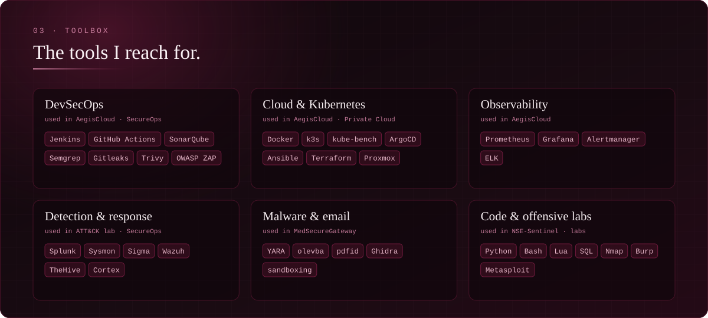




<a href="mailto:abir.majdi@usmba.ac.ma"></a>
<a href="https://www.linkedin.com/in/abir-majdi-a221bb296/"></a>
<a href="https://penelopeeckhar.github.io/portfolio/"></a>
<a href="https://tryhackme.com/p/penny1598"></a>
<a href="https://hackerdna.com/users/arael"></a>

<picture>
  <source media="(prefers-reduced-motion: reduce)" srcset="assets/footer-static.svg">
  
</picture>

